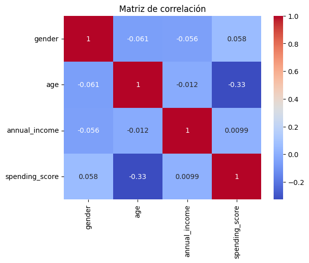
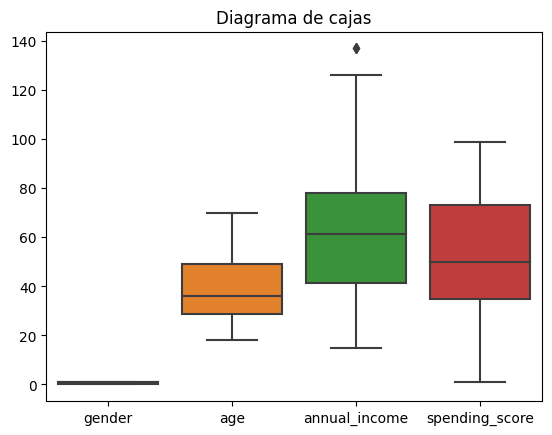
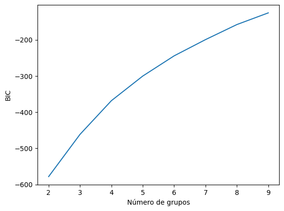

<div align="center">

# Customer Segmentation with K-Means

**Unsupervised learning to discover customer profiles in a shopping centre**

<a href="https://colab.research.google.com/github/Steven-Macas/kmeans_mall_customers/blob/main/clientes_aprendizaje_automatico_no_supervisado.ipynb"></a>     

</div>

## Overview

Customer data from a shopping centre is explored, cleaned and grouped with **K-Means** to find customer
profiles that a business could target in different ways. There are no labels: the number of groups and
their meaning are discovered from the data itself.

## Dataset

**Mall Customers** – 200 customers with gender, age, annual income (k$) and a spending score (1 – 100)
assigned by the shopping centre.

## Approach

1. **Preprocessing** – column renaming, encoding of gender and missing-value checks.
2. **Exploration** – correlation matrix, histograms and box plots to detect outliers.
3. **Scaling** – `StandardScaler` before clustering.
4. **Stability check** – jackknife resampling (leave-one-out) of K-Means to see how the error changes.
5. **Number of groups** – elbow method (sum of squared errors) and the BIC of Gaussian Mixture models.
6. **Evaluation** – silhouette and Davies-Bouldin scores.
7. **Profiling** – descriptive statistics of each group and interactive Plotly charts.

## Results

| Metric (K-Means, k = 4) | Value |
| --- | --- |
| Silhouette score | 0.297 |
| Davies-Bouldin score | 1.29 |

Example profiles found in the analysis:

- **Group 0** – 39 customers, average age 32.7, average income 84.6 k$ and spending score 82.1: young customers with high income who spend a lot.
- **Group 1** – only women, average age 47, income 61.1 k$ and spending score 35.8: older customers who spend moderately.

<table>
  <tr><td align="center" valign="top"><br /><sub>Correlation matrix</sub></td><td align="center" valign="top"><br /><sub>Box plots after scaling</sub></td><td align="center" valign="top"><br /><sub>BIC by number of groups</sub></td></tr>
</table>

## How to run

Open the notebook in Colab with the badge above and upload `Mall_Customers.csv`
([Kaggle](https://www.kaggle.com/datasets/vjchoudhary7/customer-segmentation-tutorial-in-python)).

```bash
pip install pandas scikit-learn seaborn plotly scipy jupyter
jupyter notebook clientes_aprendizaje_automatico_no_supervisado.ipynb
```

*The notebook is written in Spanish.*

---

<sub>Made by <b>Steven Macas</b> — Data Engineer &amp; Data Analyst · <a href="https://gointy.com">gointy.com</a> · <a href="https://www.linkedin.com/in/steven-macas">LinkedIn</a> · <a href="https://github.com/Steven-Macas">GitHub</a></sub>
